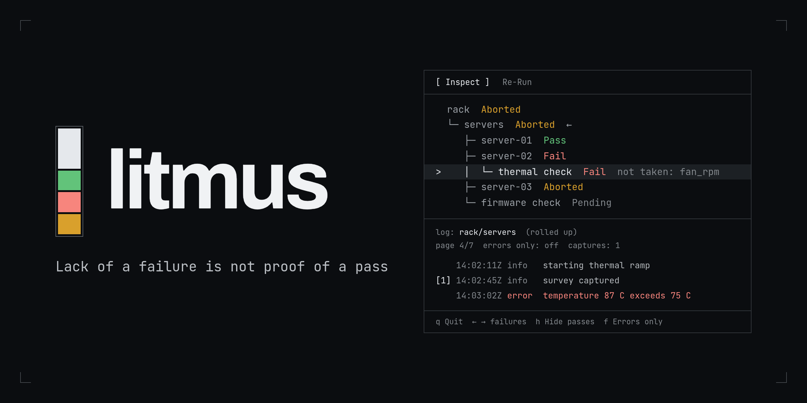

# litmus

**Hardware-in-the-loop tests that can't quietly lie, and failures a technician can
triage at 2am without calling you.**

Litmus is an opinionated HIL test framework for Python, built on asyncio structured
concurrency and sized for production lines: one bench DUT or a rack of 132 running
concurrently. You write what you claim about the hardware. Litmus enforces the verdict,
collects the evidence, and gives the floor a terminal Inspector for reading it.

> *The act of executing the test is the act of producing irrefutable evidence*

## Why

Most test scripts have exactly one way to fail: something raises. A bad unit,
a bug in the test, and a database timeout all raise, and all show up as the
same red FAIL. Was it the unit, the test, or the database? The technician on
shift guesses or escalates, and the line waits for an engineer.

Litmus sets one bar and builds everything around it:

> A Floor Technician can correctly categorize a failure and start the right recovery
> protocol **within 60 seconds** of opening the Inspector, without messaging the
> engineer who wrote the test.

## What you get

**No pass by default. EVER.** "Reached the end without throwing" proves only that none of
the failures you thought of happened. In Litmus a test method passes only by returning
the `PASS` sentinel, which can't be forged from a string, a truthy value, or parsed
config. Fall off the end and the node is **Aborted** loudly as a contract violation. 
Optionally, declare the readings a pass must carry with `@evidence(...)`, and a pass without them doesn't count.

**Three outcomes, three recovery paths.** Every node ends in exactly one of three
states, and the framework never merges them:

| State | What happened | What the floor does |
|---|---|---|
| **Pass** | An explicit verdict, with its declared evidence | Ship it |
| **Fail** | The DUT failed a modeled check, or the test hit a bug it didn't model (flagged loudly as a BUG) | Check the hardware, or escalate the defect |
| **Aborted** | No verdict exists: the harness broke, the operator stopped the rack, or a test returned nothing | Fix the harness. Don't condemn the unit |

**Evidence is a side effect of running.** Each run writes a timestamped directory with
a versioned `result.json`, a human `timeline.log` and machine `timeline.jsonl` per
node, and point-in-time artifacts stitched onto that timeline. All of it is flushed
entry by entry, so an interrupted run keeps the chronology up to the point it stopped.
With NTP-synced stations, that timeline will hold up in a customer dispute ("did the
failures start before your 2pm firmware push?").

**One building block, from a single check to a rack.** `LitmusTest` is the only unit - analogous to reacts "Component".
A leaf check, an ordered `sequence()`, a concurrent `parallel()`, a whole device, and a
70-DUT rack are all the same type, composed. No level knows what sits above it, so the
test tree mirrors the hardware tree.

**Guardrails your team can't bypass.** The rules are enforced in three tiers:

1. **Runtime.** Every call into your code passes one child boundary that owns the
   verdict, the failure taxonomy, and lifecycle order (`configure` → `build_suite` →
   `cleanup`, and cleanup always runs).
2. **Import time.** A structurally broken suite refuses to import, so it never
   reaches a fixture.
3. **Static analysis.** `litmus-check` flags an ungated `PASS` and impure composition.

Nothing that protects the hardware or the verdict relies on the linter alone.

**Safe aborts.** If the integration layer fails mid-run or the operator hits Ctrl-C,
Litmus closes every in-flight transport across the tree right away: SSH sessions
destroyed, subprocesses killed. A 30-minute firmware flash doesn't keep writing to a
board after the run has been called off. Start and finish hooks stay paired, so your
MES never gets orphan rows.

**Less plumbing.** Call `utils.use_shell()` in `configure()` and every descendant's
`utils.exec` runs over that SSH hop, including through jump hosts. `wait_for()`
requires a `looking_for=` description, which becomes the timeout message the
technician reads. Time budgets (`fail_after=` / `abort_after=`) attach to any node,
and a child can only tighten its parent's budget, never loosen it.

## What a test looks like

```python
from litmus import PASS, LitmusTest, TestFailure, TestUtils, Verdict


class HelloWorld(LitmusTest):
    def __init__(self, *, name: str, greeting: str = "hello world") -> None:
        super().__init__(name=name)
        self._greeting = greeting

    def build_suite(self) -> LitmusTest:
        return self.test("say hello", self._say_hello)

    async def _say_hello(self, utils: TestUtils) -> Verdict:
        if self._greeting:  # the claim, stated as a condition
            utils.logger.info(self._greeting)  # lands in this node's timeline
            return PASS  # the only way to pass
        raise TestFailure("nothing to say", "a greeting", "(empty)")
```

## The Inspector

`litmus inspect` opens any saved run in a terminal UI built for the person at the
station. It replays saved evidence only: no DUT, no SSH, no suite source, no risk of
running anything.

```text
  [ Inspect ]   Re-Run
  ---------------------------------------------------------
    rack  Aborted
    └─ servers  Aborted  ←
       ├─ server-01  Pass
       ├─ server-02  Fail
  >    │  └─ thermal check  Fail  not taken: fan_rpm
       ├─ server-03  Aborted
       └─ firmware check  Pending
  ---------------------------------------------------------
  log: rack/servers  (rolled up: thermal check has no own log)
  page 4/7  errors only: off  captures: 1  (1-9 opens a capture)
      14:02:11Z info     starting thermal ramp
  [1] 14:02:45Z info     survey captured
      14:03:02Z error    temperature 87 C exceeds 75 C
  q Quit  Tab Inspect / Re-Run  ← → failures  h Hide passes  n p page  f Errors only
```

- **← / →** jump between failures, skipping everything that passed. **h** folds
  the passing branches out of a large rack.
- The highlighted node's timeline updates as the cursor moves. **1–9** open the
  captured artifacts, such as survey data showing whether the device's reported
  health matched what actually happened.
- Missing readings are shown as **not taken** by name, so an absent value is never
  mistaken for zero.
- **Re-Run** is the bench: after reseating a cable, press Enter on one node to
  re-run just that subtree with the exact production code. Nothing it produces
  overwrites the production record.

The same run record is available as versioned JSON (`--json`, with published JSON
Schemas) and as JUnit XML (`--junit`) for CI and dashboards.

## Try it

Requires Python 3.14 and [uv](https://docs.astral.sh/uv/).

```sh
make install
uv run litmus run examples/hello_world.py
uv run litmus inspect
```

The locally executable examples progress from one explicit claim, through composition,
to polling, lifecycle hooks, and the evidence surface:

```sh
uv run litmus run examples/hello_world.py
uv run litmus run examples/test_composition.py::SequencedDevice
uv run litmus run examples/test_composition.py::ParallelDevice   # exits 1 by design
uv run litmus run examples/wait_for_patterns.py::ConfigureGatedDevice
uv run litmus run examples/wait_for_patterns.py::MainAssertionDevice
uv run litmus run examples/hardware_device_lifecycle.py
uv run litmus run examples/run_data_evidence.py
```

The SSH-backed examples take their target from `utils.env` in `configure()`; a missing
variable Fails the suite (exit 1) with a message that names the variable to set:

```sh
SSH_HOST=dut.lab SSH_USER=root uv run litmus run examples/remote_device_ssh.py
JUMP_HOST=jump.lab JUMP_USER=ops TARGET_HOST=dut.lab TARGET_USER=root uv run litmus run examples/ssh_tunneling.py
DUT_MAC=aa:bb:cc:dd:ee:ff uv run litmus run examples/networked_device.py::DutDevice
TARGET_ADDRESS=pihole.lab TARGET_USER=root uv run litmus run examples/pi_hole_server.py
```

The **[Getting started guide](docs/getting-started.md)** continues from there: writing
your first suite, the examples in teaching order, running against real devices over
SSH, deploying to a station, and contributing.

## Documentation

- [Getting started](docs/getting-started.md): install, first run, examples, deployment
- [Overview](docs/overview.md): the philosophy, the failure taxonomy, and the pit of success
- [Contracts](docs/contracts.md): what the framework guarantees and what it asks of you
- [Idioms](docs/idioms.md): authoring patterns
- [Inspector](docs/inspector.md) and [Floor Technician guide](docs/floor-technician.md):
  the station side
- [API stability](docs/api-stability.md): the public surface and versioning policy

Nothing hosts the docs site. The tree is the documentation: GitLab renders every
page under https://gitlab.com/Tyler-Meador/litmus_test/-/tree/main/docs, and each
release branch (`release/MAJOR.MINOR.PATCH`) also carries the built site under
`docs/site/` (`make docs-release`; open `docs/site/index.html` from a clone, no
network needed). The Floor Technician guide is `docs/floor-technician.md`; its
rendered page,
https://gitlab.com/Tyler-Meador/litmus_test/-/blob/main/docs/floor-technician.md,
is the URL that belongs on a station label.

## Status

Litmus is at 0.0.x. The public API follows semantic versioning from 1.0.0. Until then,
[API stability](docs/api-stability.md) describes what may change, and `CHANGELOG.md`
records every change.

## License

Copyright 2026 Tyler Meador. Litmus is free software, released under the GNU General
Public License, version 2 (`GPL-2.0-only`). The full text is in `LICENSE`; the copyright
notice is in `NOTICE`. There is no warranty; see the license for the terms.
